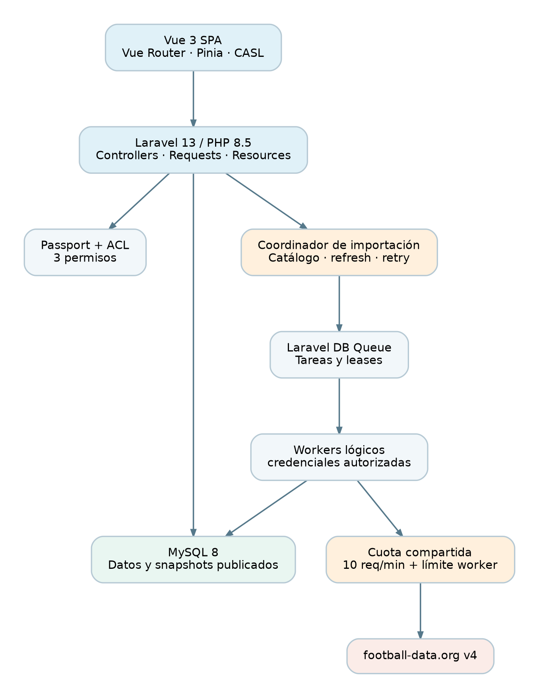
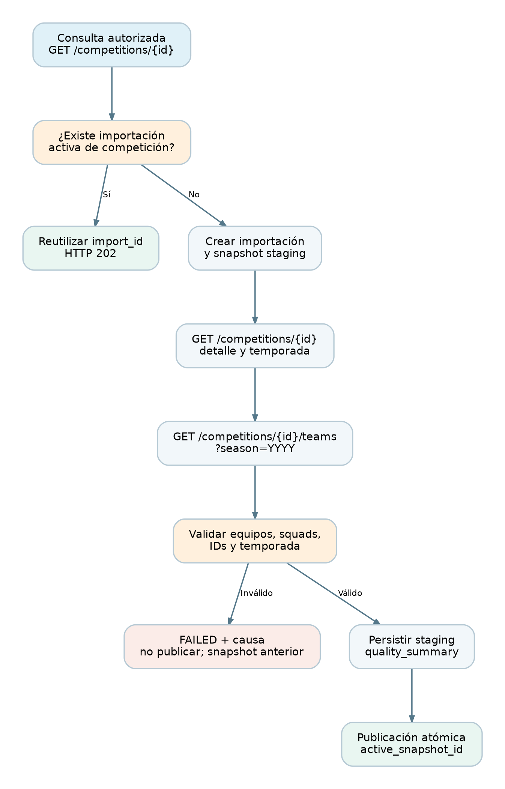
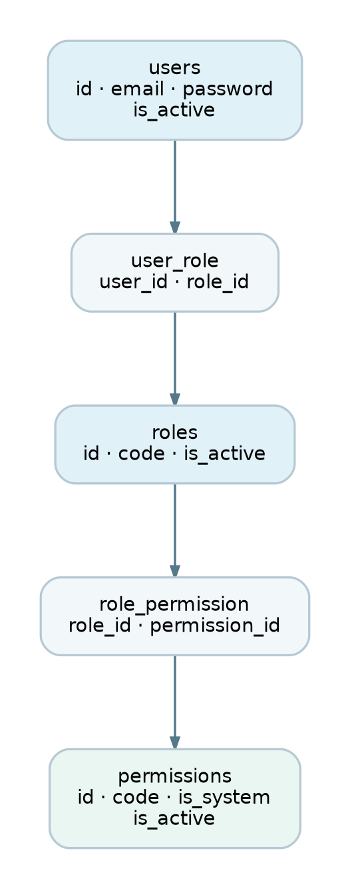
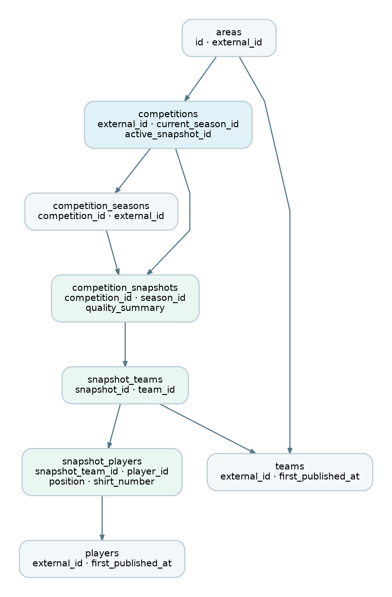
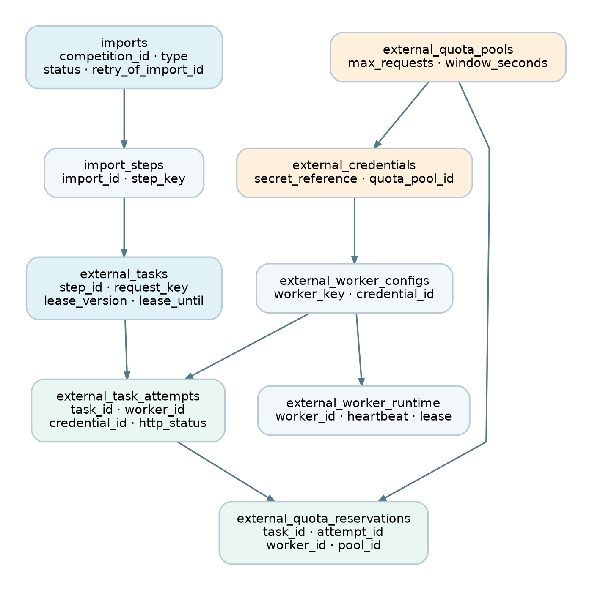
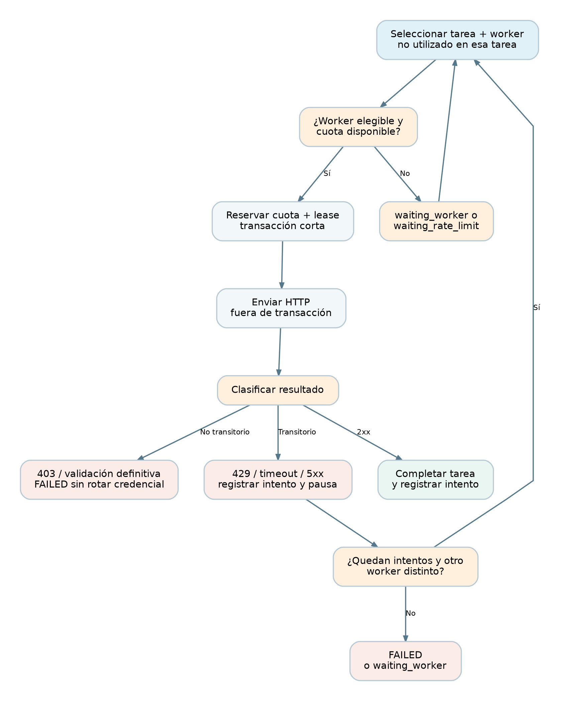
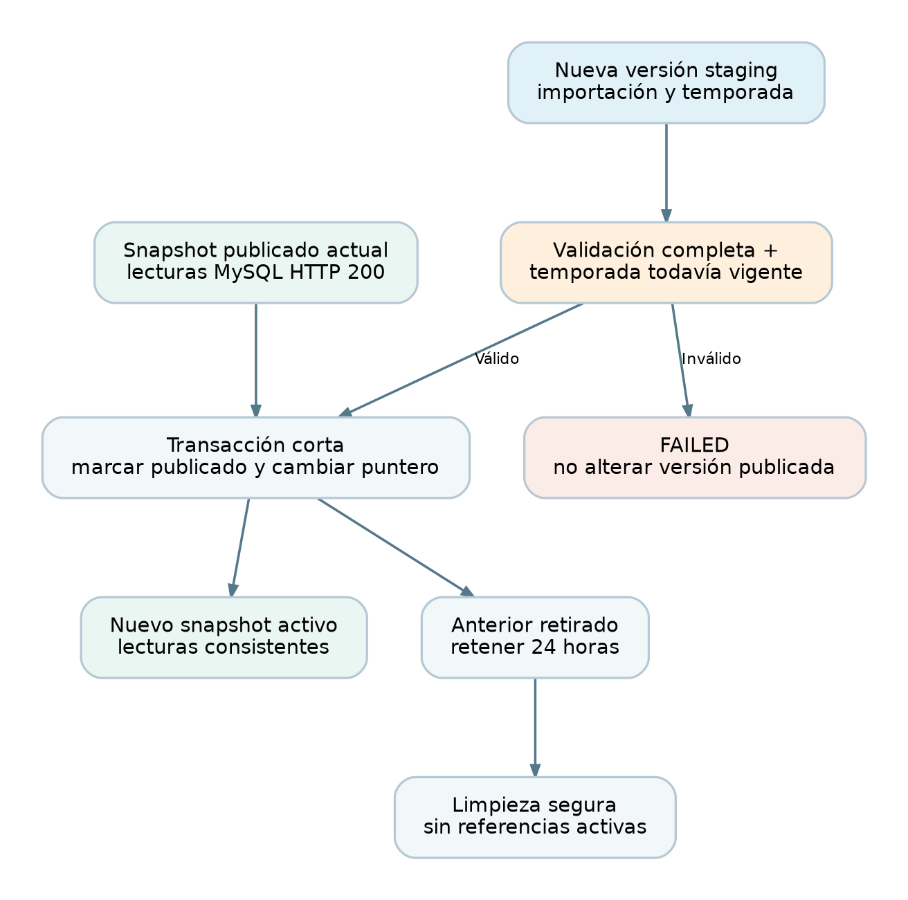
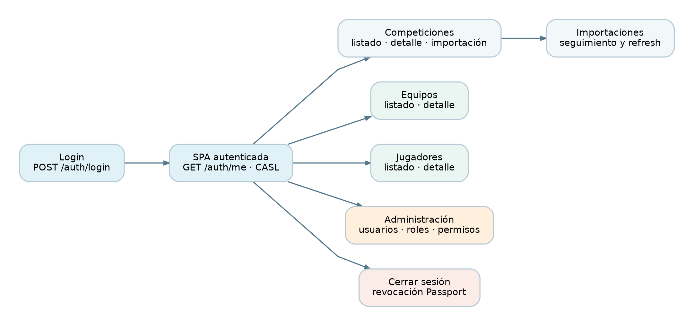

# Inca Rail · Plataforma interna de fútbol

## 1. Requisitos

- **PHP 8.5**, Composer 2, Laravel 13 y Passport compatible; Vue 3 y Vue Router; Node.js 22+ y npm; MySQL 8.
- Recomendado: Docker Engine y Docker Compose v2.
- Un token autorizado propio de [football-data.org](https://www.football-data.org/). Para ejecutar el flujo estándar basta **uno**.

**Seguridad:** ningún token, contraseña real, fichero `.env` ni claves OAuth de Passport debe versionarse. Solo se incluye `.env.example`.

## 2. Puesta en marcha con Docker

1. Copiar `backend/.env.example` a `backend/.env`.
2. Editar **en ese archivo privado** `FOOTBALL_TOKEN_A`, `ADMIN_SEED_EMAIL`, `ADMIN_SEED_PASSWORD`, `READONLY_SEED_EMAIL` y `READONLY_SEED_PASSWORD`. Utilizar contraseñas fuertes. Los valores DB de ejemplo son **solo para desarrollo local** y deben coincidir con `compose.yml`.
3. Ejecutar desde la raíz:

   ```bash
   docker compose build
   docker compose up -d db api worker-a scheduler web
   ```

4. Esperar a que `api` haya terminado `composer install` (`docker compose logs -f api`). La primera instalación requiere Internet en la máquina que ejecuta Docker.
5. Ejecutar en este orden:

   ```bash
   docker compose exec api php artisan key:generate
   docker compose exec api php artisan vendor:publish --tag=passport-migrations --force
   docker compose exec api php artisan migrate --force
   docker compose exec api php artisan passport:keys
   docker compose exec api php artisan passport:client --personal
   docker compose exec api php artisan db:seed --force
   docker compose exec api php artisan football:catalog
   ```

6. Abrir **http://localhost:5173** e ingresar con las credenciales sembradas. La API está en **http://localhost:8000/api**. El catálogo se completa **asíncronamente** mediante `worker-a`: puede tardar; volver a consultar la SPA tras unos segundos.

> **Importante:** el comando `passport:client --personal` puede solicitar parámetros de manera interactiva; completar las preguntas con el proveedor `users`. Estas opciones no pudieron verificarse ejecutándolas aquí.

### Varias credenciales autorizadas

La instalación estándar levanta solo `worker-a`. Si el proveedor permite expresamente utilizar otras credenciales, configurar `FOOTBALL_TOKEN_B` y `FOOTBALL_TOKEN_C` y levantar:

```bash
docker compose --profile multi up -d worker-b worker-c
```

Las credenciales no se almacenan en MySQL: `external_credentials.secret_reference` solo contiene nombres de variables (`FOOTBALL_TOKEN_A`, etc.). **Se mantiene el límite conservador global de 10 peticiones por 60 segundos**, incluso si se levantan varios workers. No se ha demostrado que el proveedor permita sumar cuotas por token.

### Sin Docker

En un entorno con PHP 8.5/Composer 2, MySQL 8 y Node 22:

1. `cd backend && composer install && cp .env.example .env`.
2. Configurar `.env` con `DB_HOST=127.0.0.1`, base de datos existente y usuarios de seed.
3. `php artisan key:generate && php artisan vendor:publish --tag=passport-migrations && php artisan migrate && php artisan passport:keys && php artisan passport:client --personal && php artisan db:seed && php artisan football:catalog`.
4. Ejecutar API: `php artisan serve --port=8000`.
5. En otra terminal: `EXTERNAL_WORKER_KEY=worker-a php artisan queue:work database --queue=football --sleep=2 --timeout=35 --tries=0`.
6. En otra terminal, periódicamente: `php artisan football:wake` (cada 30 segundos recomendado).
7. `cd frontend && npm install && npm run dev`, luego entrar en `http://localhost:5173`.

## 3. Tecnología y organización

- **Backend:** Laravel 13, Eloquent, Passport Personal Access Tokens, Form Requests, JSON Resources, controladores delgados, Services y Jobs.
- **Frontend:** Vue 3, Vue Router, Pinia, CASL, Axios y CSS responsive. Autenticación con cookie de sesión `HttpOnly`, cifrada, recuperación del perfil al recargar y protección CSRF.
- **Datos:** MySQL 8, 22 tablas de dominio, más tablas de infraestructura, Passport y Laravel Queue.
- **Integración:** un único cliente HTTP `FootballClient`; la API de lectura accede a MySQL, no a football-data.
- **Infraestructura opcional:** Compose para MySQL, API, worker, scheduler y Vite.

Los servicios están organizados en `Services/Football` (lecturas), `Services/Imports` (validación y publicación), `Services/ExternalTasks` (cuotas y workers) y `Services/Administration` (mutaciones ACL). Los controladores reciben solicitudes validadas y serializan respuestas. La correspondencia con el documento maestro v2.11 está en [Organización y funcionamiento del backend](docs/09_backend_implementacion.md).

La [documentación técnica del proceso](docs/10_proceso_tecnico.md) explica instalación/migraciones, entrada a cada vista, importaciones, reemplazo de datos, workers, scheduler y consultas para identificar quién ejecutó cada tarea. El [modelo entidad-relación](docs/11_modelo_entidad_relacion.md) incluye diagramas y las claves verificadas del esquema actual.

Docker guarda las dependencias PHP en el volumen compartido `php_vendor`, para evitar lecturas lentas de `vendor` desde Windows. El código fuente permanece montado desde `backend/`. Ejecutar Composer dentro del contenedor `api`; OPcache está habilitado para el servidor local y valida cambios del código. Vite sirve el frontend en desarrollo sin recompilar manualmente.

El servicio web activa `VITE_USE_POLLING=true` para que Vite detecte modificaciones de archivos montados desde Windows. Después de cambiar esta configuración, recrear el servicio con `docker compose up -d --no-deps --force-recreate web`.

## 4. Seguridad y ACL

| Permiso | Qué permite |
|---|---|
| `football.view` | Consultar competiciones, equipos, jugadores e importaciones |
| `football.manage` | Importar, actualizar y reintentar |
| `administration.manage` | Administrar usuarios, roles y permisos |

Roles de seed: `admin` = los tres; `readonly` = solo `football.view`. **Los permisos no se implican entre sí**. Laravel revalida usuario activo y permisos en cada request. La SPA usa capacidades equivalentes para ocultar controles, pero **no sustituye la autorización del servidor**.

La administración impide asignar permisos que el actor no tiene y conserva, bajo transacción, al menos un administrador activo con las tres capacidades. Los tres permisos del sistema no pueden desactivarse ni cambiar de código. Los permisos personalizados no habilitan endpoints sin lógica explícita; crearlos no implica poder asignarlos sin la debida autorización.

## 5. Contratos REST

Todas las rutas bajo `/api`; login y preparación CSRF son públicos. El [flujo de autenticación por cookies](docs/12_autenticacion_cookies.md) describe contratos, validaciones y configuración.

| Método | Ruta | Permiso |
|---|---|---|
| POST | `/auth/login` | Público |
| GET | `/auth/csrf-cookie` | Público; prepara cookies de sesión y CSRF |
| POST | `/auth/logout` | Autenticado |
| GET | `/auth/me` | Autenticado |
| GET | `/competitions` | `football.view` |
| GET | `/competitions/{competition_id}` | `football.view`; importación implícita solo si además `football.manage` |
| GET | `/team` | `football.view` |
| GET | `/team/{team_id}` | `football.view`; importación implícita de equipo sin publicación solo si además `football.manage` |
| GET | `/players` | `football.view` |
| GET | `/players/{player_id}` | `football.view`; importación implícita de jugador sin publicación solo si además `football.manage` |
| GET | `/imports/{import_id}` | `football.view` |
| POST | `/competitions/{competition_id}/refresh` | `football.manage` |
| POST | `/team/{team_id}/refresh` | `football.manage` |
| POST | `/players/{player_id}/refresh` | `football.manage` |
| POST | `/imports/{import_id}/retry` | `football.manage` |
| GET/POST/PATCH/PUT | `/users`, `/roles`, `/permissions` y sus rutas de detalle/asignación | `administration.manage` |

Respuestas: `success`, `data`, `message`, `meta`, `error`. HTTP 200, 201, 202, 401, 403, 404, 419, 422, 429, 503 según la operación. El 419 indica CSRF ausente o caducado. `GET /imports/{id}` exitoso devuelve HTTP 200 aunque el proceso esté en `failed`. Los fallos HTTP externos conservan en `error_message` el estado HTTP y el campo `message` del proveedor cuando es texto no vacío; el detalle de la ficha lo expone como `data.import.error_message`. Las lecturas ya publicadas siempre se sirven desde MySQL, incluso con proveedor caído. Cuando no hay snapshot y la consulta autorizada depende de un proveedor cuyo último intento falló por indisponibilidad, podrá devolver 503.

Los listados `/team` y `/players` exponen entidades publicadas **alguna vez** (`first_published_at`), sin duplicarlas; los detalles agrupan participaciones en snapshots **actualmente activos**.

`GET /competitions/{competition_id}` devuelve `data.competition`, `data.import` y `data.snapshot`. El snapshot es `null` si todavía no hay una publicación; cuando existe contiene su temporada, los totales de equipos/jugadores y los equipos con sus plantillas. La pantalla de competición permite buscar equipos y abrir directamente sus fichas mediante IDs externos al seleccionar una tarjeta. Los nombres y campos de participación se leen de la versión publicada.

Un ID de competición fuera del catálogo puede consultarse con `football.manage`: se crea una referencia local y se inicia una importación asíncrona idempotente. Si el proveedor rechaza la consulta y no existe un snapshot publicado, la SPA vuelve a la página de origen y muestra el código, el mensaje completo del proveedor y el ID de importación. Si se abre directamente sin un origen local conocido, vuelve a Competiciones. Un readonly no crea referencias ni tareas; recibe un 404 con una explicación pública. Las referencias aún no publicadas ni obtenidas del catálogo no aparecen en el listado de competiciones.

Un equipo sin publicación, como `/team/8772`, sigue la misma política: con `football.manage` inicia o reutiliza una importación individual y responde 202 mientras está pendiente. `data.has_data` indica si existe una publicación. Si el proveedor rechaza la consulta, la SPA vuelve al origen con el mensaje completo; un acceso directo vuelve a Equipos. Una respuesta válida publica el perfil y la plantilla recibida sin crear un snapshot de competición. Las referencias fallidas no aparecen en el listado y un readonly recibe un 404 público sin crear tareas.

Las personas/jugadores de `/players/{id}` también siguen esta política, mediante una sola consulta asíncrona a `/persons/{id}`. Si no hay datos y la importación falla, regresan al equipo o listado que abrió la ficha con el mensaje completo del proveedor; el acceso directo vuelve a Jugadores.

El detalle individual del equipo se conserva en `teams.source_profile` y devuelve `data.team.squad`; esta plantilla se muestra primero incluso si `data.participations` contiene plantillas vacías. Las plantillas de competiciones siguen disponibles por participación/temporada. El detalle del jugador se conserva en `players.source_profile` e incorpora `current_team`, contrato, posición y `shirt_number` recibido desde `shirtNumber`. Estos refrescos mantienen los snapshots publicados y conservan la última información válida si falla el proveedor. Su estado aparece en `data.import` y puede consultarse en `/imports/{id}`.

En una instalación existente, aplicar las nuevas columnas antes de usar estos controles:

```bash
docker compose exec -T api php artisan migrate --force
docker compose exec -T api php artisan queue:restart
```

## 6. Importación y limitación del proveedor

1. `football:catalog` o primer acceso autorizado con `football.manage` y catálogo nunca inicializado crea una importación idempotente (no la repite en cada GET). Un readonly no crea tareas.
2. Seleccionar por primera vez una competición desde cuenta `admin` inicia un trabajo **HTTP 202**: se obtienen detalle `/competitions/{id}` y luego equipos con `squad` de `/competitions/{id}/teams?season=YYYY`.
3. La importación de una competición no consulta recursivamente `/teams/{id}` ni `/persons/{id}`. Los detalles individuales se solicitan mediante el refresco explícito de su ficha o el primer acceso autorizado a un equipo o jugador sin publicación. La competición publica todos los equipos aunque su plantilla esté ausente, sea `null` o esté vacía, y conserva los jugadores que sí llegan. Las posiciones o camisetas individuales ausentes se almacenan como `NULL`.
   `quality_summary` identifica las plantillas ausentes y vacías mediante cantidades, IDs, nombres y motivos, tanto en la importación como en el snapshot publicado. Las fichas de los clubes siguen disponibles y la pantalla avisa cuando no recibió jugadores. Una plantilla con estructura inválida (por ejemplo, texto en lugar de una lista) falla con `SOURCE_SQUAD_INVALID`; los IDs, temporadas, duplicados y campos de jugadores siguen validándose. Esta política sustituye la restricción de completitud P03 del documento v2.11 por la actualización solicitada.
4. Antes de publicar se verifica ID de competición, temporada, cantidad de equipos, IDs de jugadores, unicidad y estructura. Los snapshots pasan de preparación a publicados por una transacción que cambia `active_snapshot_id`.
5. Las lecturas mantienen el snapshot antiguo si un refresh falla o si cambia la temporada, con `needs_refresh`.
6. Solo una importación por competición, equipo o jugador puede estar activa a la vez en su propio ámbito. Reintentar una fallida requiere `POST /imports/{id}/retry` y genera un ID nuevo; las importaciones de competición generan además un snapshot nuevo.
7. `football:wake` recupera tareas con lease vencido o en espera de un worker distinto y limpia versiones retiradas/fallidas después de 24h con comprobaciones de referencias.

**Cuotas y reintentos:** la reserva de cuota centralizada se persiste **antes** de HTTP, con bloqueos breves en MySQL. Un fallo con envío incierto consume cuota conservadoramente. Se permiten **hasta 3 intentos de una tarea externa con workers y credenciales distintos**, nunca tres intentos internos del Job. Solo 429/5xx/conexión/timeout son transitorios. Si únicamente existe `worker-a`, un fallo transitorio deja la tarea en `waiting_worker` hasta disponer de otro worker autorizado. Los errores 403 de recurso no rotan tokens automáticamente. El límite inicial global es 10/60s, aunque existan varias credenciales.

## 7. Documentación de arquitectura

Todos los diagramas se incluyen como `.png` y `.drawio` editable en `docs/`.

### Arquitectura general



SPA Vue → API Laravel protegida por Passport → MySQL. Los Jobs de importación usan workers con control de cuota compartido antes de comunicarse con football-data.

### Flujo de importación



Muestra la iniciación HTTP 202, las etapas de consulta, validación y publicación. Un error mantiene intacto el snapshot anterior.

### Modelo ACL



Usuarios, roles y permisos mediante tablas pivote y tres permisos iniciales sin jerarquías implícitas.

### Modelo de fútbol



Identidades globales separadas de participaciones por snapshot y temporada; deduplicación y publicación atómica.

### Workers



Credenciales referenciadas por variables, configuración de workers, tareas y reservas globales de cuota.

### Reintentos y cuotas



Tres intentos con workers distintos, espera si no hay worker elegible y control global de 10 solicitudes/minuto.

### Publicación de snapshots



Cambio de puntero al snapshot validado, versiones anteriores conservadas y limpieza segura.

### Navegación SPA



Login, catálogo, equipos, jugadores y gestión ACL con rutas de frontend condicionadas por permisos.

«Volver» respeta el origen de la ficha: un equipo abierto desde una competición regresa a esa competición; desde el listado de equipos regresa al listado. Un jugador abierto desde una plantilla vuelve al equipo, conservando su origen, y desde el listado de jugadores vuelve a ese listado. Los enlaces directos sin origen regresan al listado correspondiente.

Los enlaces de competición en equipos, jugadores y datos de snapshot, y los enlaces de equipo desde jugadores, también conservan su origen. Cuando una competición, equipo o jugador sin publicación falla al importarse o la API no encuentra información, la vista regresa mediante reemplazo de la ruta y deja un aviso que puede cerrarse en la página de origen. Los fallos de refresco con datos publicados mantienen la ficha y el error en el panel común.

## 8. Pruebas

Después de instalar dependencias, base de datos, Passport y configurar `.env`, ejecutar:

```bash
docker compose exec -T api composer test -- --compact
docker compose exec -T api composer lint
docker compose exec -T web npm test
```

Las pruebas PHP usan SQLite **en memoria** (configurado en `backend/phpunit.xml`), colas falsas y HTTP simulado: no modifican MySQL de desarrollo ni consumen cuota externa. Cubren ACL y último administrador, contratos API, importación sintética de 24 equipos/677 jugadores, campos incompletos, snapshots, publicación atómica, cuota compartida, workers distintos, errores del proveedor y retención. La concurrencia real de locks entre procesos MySQL y la instalación desde cero siguen requiriendo una comprobación específica. Ver [la guía del backend](docs/09_backend_implementacion.md) para detalles y límites de validación.

Para aplicar el formato del proyecto: `docker compose exec -T api composer format`. `composer lint` lo comprueba sin modificar archivos.
