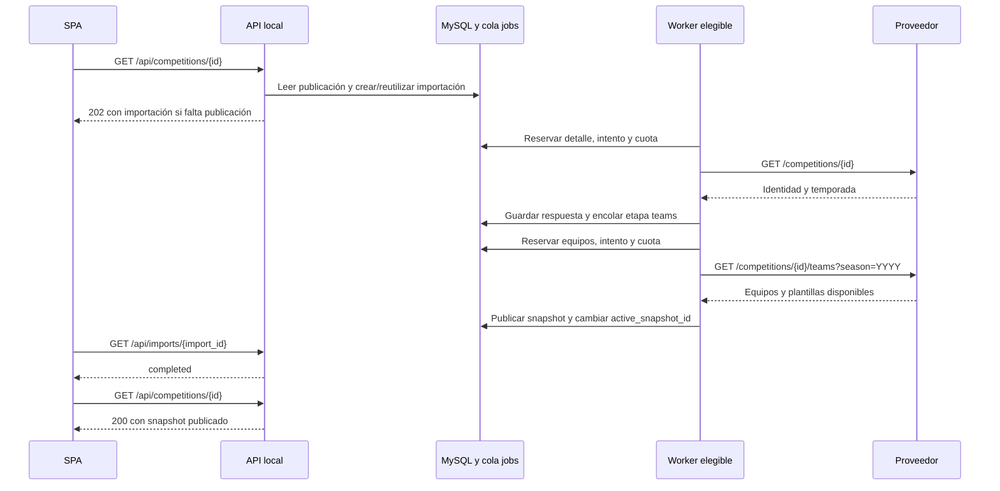

# Proceso técnico: instalación, consultas, importaciones y workers

Esta guía describe el comportamiento implementado en el repositorio. Se contrastó con las migraciones, los servicios, las vistas y el esquema MySQL local. La configuración de servicios observada corresponde al momento de esta revisión; puede cambiar al levantar o detener contenedores.

El [modelo entidad-relación](11_modelo_entidad_relacion.md) detalla tablas, claves, cardinalidades y relaciones. La [guía de implementación](09_backend_implementacion.md) contiene la organización de clases y el historial de verificaciones.

## 1. Migración inicial e importación inicial

Son operaciones con efectos distintos:

| Operación | Entrada | Resultado |
|---|---|---|
| Migración de base de datos | `php artisan migrate` | Crea o modifica tablas, columnas, índices y claves foráneas. |
| Seed de configuración | `php artisan db:seed` | Registra permisos, roles, usuarios configurados, pool de cuota, credenciales referenciadas y workers. |
| Importación del catálogo | `php artisan football:catalog` o primer GET autorizado del catálogo | Encola una consulta a `/competitions` del proveedor y guarda sus identidades/temporadas. |
| Importación inicial de una competición | Primer GET autorizado de su ficha sin publicación ni importación previa | Encola detalle y equipos; publica un snapshot cuando se valida toda la respuesta. |
| Importación individual | Primer GET autorizado de un equipo/jugador sin publicación ni importación previa | Encola un único detalle de equipo o persona y publica su perfil local. |

Las migraciones y el seed no descargan equipos ni jugadores. El proceso HTTP de la API no espera a que termine una importación externa: crea el trabajo y devuelve su estado para seguimiento.

### 1.1 Archivos de migración

| Archivo | Efecto |
|---|---|
| `2026_10_10_000001_create_domain_tables.php` | Crea 22 tablas de negocio y 7 de infraestructura. Agrega al final las FK circulares de la competición hacia su temporada actual y snapshot activo. |
| `2026_10_11_000001_add_entity_refresh_details.php` | Agrega `source_profile` y `source_fetched_at` a `teams`/`players`, y `team_id`/`player_id` a `imports`. |
| `2026_10_11_025646_create_oauth_auth_codes_table.php` | Crea códigos de autorización de Passport. |
| `2026_10_11_025647_create_oauth_access_tokens_table.php` | Crea tokens de acceso de Passport. |
| `2026_10_11_025648_create_oauth_refresh_tokens_table.php` | Crea tokens de renovación de Passport. |
| `2026_10_11_025649_create_oauth_clients_table.php` | Crea clientes OAuth de Passport. |
| `2026_10_11_025650_create_oauth_device_codes_table.php` | Crea códigos de autorización de dispositivos. |

Laravel registra cada archivo ejecutado y su lote en `migrations`. El esquema revisado contiene **35 tablas**: 22 de negocio, 7 de infraestructura, 5 de Passport y `migrations`. Las siete migraciones anteriores estaban aplicadas. Las FK hacia tablas creadas más tarde se incorporan después de crear esas tablas; el rollback de la migración de dominio elimina primero las referencias circulares de `competitions`.

### 1.2 Orden de una instalación nueva

Preparar `backend/.env` con conexión MySQL, usuarios del seed y las credenciales autorizadas del proveedor. Los valores secretos permanecen en ese archivo; `external_credentials` guarda solamente el nombre de la variable que contiene cada token.

Desde la raíz del proyecto:

```bash
docker compose build
docker compose up -d db api
```

Esperar a que el servicio `api` termine `composer install`. En una instalación nueva, inicializar aplicación, esquema, Passport y seed:

```bash
docker compose exec -T api php artisan key:generate
docker compose exec -T api php artisan migrate --force
docker compose exec -T api php artisan passport:keys
docker compose exec api php artisan passport:client --personal
docker compose exec -T api php artisan db:seed --force
docker compose up -d worker-a scheduler web
docker compose exec -T api php artisan football:catalog
```

El cliente personal de Passport puede solicitar datos interactivos; corresponde al proveedor `users`. Las migraciones de Passport ya están incluidas en el repositorio. `football:catalog` encola el trabajo; la finalización depende del worker, la cuota y la respuesta externa.

En una instalación existente, `migrate --force` aplica únicamente los archivos pendientes. Después de actualizar código utilizado por procesos de cola, `php artisan queue:restart` solicita su reinicio; Compose vuelve a iniciarlos por `restart: unless-stopped`. La API valida cambios de PHP mediante OPcache y Vite detecta cambios del frontend mediante polling del volumen.

### 1.3 Configuración sembrada

`DatabaseSeeder` registra los permisos independientes `football.view`, `football.manage` y `administration.manage`; el rol `admin` tiene los tres y `readonly` tiene `football.view`. Crea los usuarios cuando sus credenciales de seed están configuradas.

También crea el pool `football-data-global`, las referencias `FOOTBALL_TOKEN_A/B/C`, sus credenciales `credential-a/b/c` y las configuraciones `worker-a/b/c`. Sembrar una referencia de credencial no agrega el token al archivo privado ni inicia un proceso Docker. El seed no rellena `external_worker_runtime`; ese registro se actualiza cuando el worker intenta reservar una tarea.

## 2. Qué ocurre al abrir cada vista

Todas las rutas de consulta requieren sesión activa y `football.view`. Las importaciones implícitas requieren además `football.manage`. El ID usado en URLs de fútbol es el `external_id` del proveedor; las FK y los IDs de importación/snapshot son internos de MySQL.

Al iniciar o recargar la SPA, el router espera `GET /api/auth/me` con la cookie de sesión protegida antes de abrir una vista. Un login válido prepara CSRF y entrega el token de Passport mediante cookie `HttpOnly`; las mutaciones verifican el encabezado CSRF. La [documentación de autenticación por cookies](12_autenticacion_cookies.md) detalla recuperación, vencimiento, logout y seguridad.

| Vista SPA | Solicitud a la API | Lectura o trabajo inicial |
|---|---|---|
| `/competitions` | `GET /api/competitions` | Lee el catálogo local; puede encolar su primera sincronización. |
| `/competitions/{id}` | `GET /api/competitions/{id}` | Lee el snapshot activo; puede encolar la primera importación de esa competición. |
| `/team` | `GET /api/team` | Lista equipos publicados alguna vez. |
| `/team/{id}` | `GET /api/team/{id}` | Lee perfil y participaciones; puede encolar un detalle individual aún no publicado. |
| `/players` | `GET /api/players` | Lista jugadores publicados alguna vez. |
| `/players/{id}` | `GET /api/players/{id}` | Lee perfil y participaciones; puede encolar un detalle de persona aún no publicado. |

El listado de equipos usa `/team` en singular. El proveedor externo usa `/teams/{id}` y `/persons/{id}` para sus detalles individuales. La SPA accede a la API local mediante el proxy de Vite; las consultas externas se ejecutan en los workers mediante `FootballClient`.

### 2.1 Entrar al listado de competiciones

1. `Competitions.vue` ejecuta `load()` al montarse y solicita búsqueda/paginación; usa 20 resultados por página.
2. `FootballController::competitions` evalúa el permiso de importación. Si existe, llama a `ImportCoordinator::ensureCatalog`.
3. `ensureCatalog` devuelve sin crear trabajo cuando ya existe alguna competición con `catalog_fetched_at`. Si no hay catálogo, bloquea el pool compartido y reutiliza la importación de tipo `catalog` existente, incluso si falló. Cuando nunca se solicitó, crea `imports`, su etapa `catalog`, la tarea externa y el Job de cola.
4. `FootballReadService::competitions` consulta MySQL. Incluye entradas obtenidas del catálogo o con `active_snapshot_id`; una referencia creada por acceso directo todavía no publicada no aparece como resultado del listado.
5. La API devuelve HTTP 200 con filas locales y metadatos de paginación, aunque la sincronización recién encolada siga pendiente. La pantalla muestra el catálogo vacío/sincronizándose y permite volver a consultar con **Actualizar**. Este listado no sondea un ID de importación.

El worker resuelve el recurso `catalog` como `GET /competitions` del proveedor. `ImportPersistence::catalog` valida la lista y actualiza `areas`, `competitions` y las temporadas recibidas; marca `catalog_fetched_at` y cierra la importación. El catálogo no publica plantillas. Para solicitar una nueva sincronización explícita del catálogo se utiliza `football:catalog --force`, que respeta una importación activa existente.

### 2.2 Entrar al detalle de competición

`CompetitionDetails::get` busca la identidad y carga temporada actual, snapshot activo, equipos y jugadores mediante relaciones anticipadas.

| Situación | Comportamiento |
|---|---|
| Hay snapshot activo | Devuelve HTTP 200 y esa publicación, incluso durante un refresco o después de un fallo. |
| No hay snapshot ni importación previa; usuario con `football.manage` | Crea o reutiliza la identidad, inicia una importación `initial` y devuelve HTTP 202. |
| Hay trabajo activo sin snapshot | Reutiliza el trabajo y entrega su estado para seguimiento; un usuario con permiso de importación recibe HTTP 202. |
| El intento anterior falló | El GET no lo reinicia automáticamente. Expone el diagnóstico; un fallo `SOURCE_UNAVAILABLE` sin snapshot devuelve 503 para un usuario con permiso de importación. |
| ID ausente; readonly | Devuelve 404 con explicación pública y no crea trabajo. |
| ID conocido por catálogo, sin publicación; readonly | Devuelve los datos locales de la competición, `snapshot: null` y el estado disponible; no inicia una importación. |

La importación de competición tiene dos etapas secuenciales:

| Etapa | `external_tasks.resource` | HTTP al proveedor | Persistencia |
|---|---|---|---|
| `detail` | `competition_detail:{external_id}` | `/competitions/{id}` | Valida ID, actualiza identidad/área, obtiene `currentSeason` y guarda `imports.season_id`. |
| `teams` | `competition_teams:{external_id}:{YYYY}` | `/competitions/{id}/teams?season=YYYY` | Valida equipos/plantillas y publica el snapshot. |

`YYYY` proviene del año de `currentSeason.startDate`. El ID externo de temporada puede ser otro número: no se usa como año del parámetro `season`.



Cada etapa puede ser atendida por cualquiera de los workers elegibles; el dibujo usa un participante para representar ese papel. La competición muestra tarjetas que abren directamente `/team/{external_id}`, conservando el origen en `from`.

### 2.3 Entrar a equipos

El listado `/team` consulta `FootballReadService::teams`, filtra `first_published_at IS NOT NULL`, busca por nombre y pagina resultados. Entrar al listado no descarga equipos externos.

En la ficha, `TeamDetails` resuelve el ID y `FootballReadService::team` reúne:

- Identidad de `teams` y su `area`.
- Perfil individual de `teams.source_profile`, si existe, incluida su `squad`.
- Participaciones de `snapshot_teams` en snapshots activos y sus `snapshot_players`.
- Última importación relacionada por `imports.team_id`.

Cuando falta una publicación, el acceso autorizado crea o reutiliza una referencia `Equipo #{id}`, mantiene `first_published_at` en `null`, encola `team_refresh` con etapa `team_detail` y responde 202 mientras está pendiente. Esa etapa consulta solamente `/teams/{id}`. Los integrantes de la plantilla se registran a partir de la respuesta recibida; no se consulta `/persons/{id}` para cada integrante.

Una respuesta válida publica perfil y plantilla y marca el equipo y los jugadores nuevos como consultables. Una respuesta inválida o rechazada deja la referencia sin publicar. El siguiente GET expone la importación fallida y no crea otra. Un readonly recibe 404 para equipos ausentes o pendientes. La ficha usa `data.has_data` para distinguir datos publicados de una referencia.

### 2.4 Entrar a jugadores/personas

El listado `/players` filtra identidades publicadas alguna vez y consulta exclusivamente MySQL.

`PlayerDetails` y `FootballReadService::player` reúnen identidad y `players.source_profile`, participaciones de `snapshot_players`, sus equipos/competiciones/temporadas activas y la última importación por `imports.player_id`.

Sin publicación, un usuario con `football.manage` puede crear o reutilizar `Jugador #{id}` y encolar `player_refresh` con etapa `player_detail`. Se solicita únicamente `/persons/{id}`. Una respuesta válida publica el perfil, convierte `shirtNumber` en `shirt_number` y marca `first_published_at`; no consulta el equipo actual ni crea un snapshot de competición. Un rechazo o ID incorrecto mantiene la referencia fuera del listado y conserva el error en la importación. El readonly recibe 404 público sin crear referencias ni tareas.

`current_team`, contrato, entrenador y competiciones declaradas pueden estar dentro de JSON. Esos objetos no crean por sí mismos relaciones de participación ni identidades locales de equipos/competiciones. Abrir uno de sus enlaces puede iniciar posteriormente la consulta autorizada de esa entidad.

### 2.5 Seguimiento y regreso ante errores

Las fichas sondean `GET /api/imports/{id}` de forma secuencial, con tres segundos entre consultas. Al completarse la importación vuelven a leer su detalle. Un HTTP 200 de `/imports/{id}` significa que se pudo consultar el proceso: su `data.status` todavía puede ser `failed`.

Cuando no hay publicación y el trabajo falla, las fichas vuelven al origen local mediante `router.replace`, mostrando el código, el mensaje del proveedor y el ID de importación. También gestionan errores iniciales 403/404/503 y respuestas vacías sin datos ni trabajo activo. `useImportRedirect`/`importNotice` comparten ese aviso. Sin origen válido, vuelven al listado correspondiente. Un refresco fallido sobre datos publicados conserva la ficha y presenta el diagnóstico en **Actualización y publicación**. Los errores transitorios de red permiten reintentar sin redirigir.

## 3. Actualización y reemplazo de información

### 3.1 Entradas de actualización

| Acción | API o comando | Efecto |
|---|---|---|
| Recargar datos de una ficha publicada | GET de su detalle | Lee la publicación/caché existente. |
| Refrescar competición | `POST /api/competitions/{id}/refresh` | Crea o reutiliza importación `refresh`; requiere identidad local. |
| Refrescar equipo | `POST /api/team/{id}/refresh` | Crea o reutiliza importación individual; admite ID aún no registrado. |
| Refrescar jugador | `POST /api/players/{id}/refresh` | Crea o reutiliza importación individual; admite ID aún no registrado. |
| Reintentar importación de entidad fallida | `POST /api/imports/{id}/retry` | Crea una importación nueva con `retry_of_import_id`, o reutiliza una activa del mismo ámbito. |
| Resincronizar catálogo | `php artisan football:catalog --force` | Crea un trabajo nuevo si no hay catálogo activo. |
| Recuperar metadatos históricos de clubes | `php artisan football:backfill-team-profiles` | Usa respuestas locales guardadas y actualiza metadatos de sus snapshots activos; no llama al proveedor. |

Los POST requieren `football.manage` y responden 202. Un refresco y un GET repetidos no multiplican un trabajo activo. `ImportCoordinator` bloquea la entidad y utiliza `active_scope_key`, único mientras el proceso siga activo: `catalog`, `competition:{id_interno}`, `team:{id_interno}` o `player:{id_interno}`. Al completar o fallar se libera ese scope poniéndolo en `null`. Una nueva importación conserva el historial de la anterior.

### 3.2 Reemplazo de una competición publicada

`SnapshotPublisher` realiza la publicación en una transacción y bloquea competición e importación. Comprueba que la temporada corresponda a la competición y siga siendo la actual para esa importación.

1. Crea el snapshot asociado a la importación con `build_status = staging`.
2. Actualiza o inserta identidades globales de equipos/jugadores por `external_id`; crea sus filas de participación en `snapshot_teams` y `snapshot_players`.
3. Conserva nombres, escudos, perfil, posiciones y dorsales propios de esa versión. Los IDs de identidad permiten enlazar fichas sin duplicar la entidad global.
4. Marca el snapshot anterior con `retired_at`.
5. Marca el nuevo como `published`, fija `published_at` y cambia `competitions.active_snapshot_id`.
6. Marca identidades nuevas con `first_published_at`, completa la importación y libera el scope.

El cambio de publicación visible ocurre al confirmar la transacción. Un fallo revierte la nueva publicación y mantiene el puntero anterior. La etapa previa de detalle puede haber actualizado identidad o `current_season_id`; los equipos/plantillas visibles siguen perteneciendo al snapshot anterior. `needs_refresh` señala cuando temporada actual y publicada difieren.

La nueva versión contiene los equipos/jugadores recibidos en esa importación. Una plantilla ausente, `null` o vacía permite publicar el equipo con cero jugadores y métricas en `quality_summary`; no se copian jugadores de la versión anterior para rellenarla. Estructuras inválidas, duplicados o datos malformados hacen fallar la importación.

### 3.3 Reemplazo de un perfil individual

`EntityDetailPublisher` valida primero y después bloquea entidad e importación dentro de una transacción:

| Entidad | Datos que actualiza | Datos conservados |
|---|---|---|
| Equipo | Campos globales, área, `source_profile` completo con plantilla recibida, `source_fetched_at` y primera publicación si faltaba. Inserta/actualiza identidades de los integrantes recibidos. | Snapshots de competición y sus participaciones anteriores. |
| Jugador | Campos personales globales, `source_profile` completo con posición/dorsal/equipo/contrato, `source_fetched_at` y primera publicación si faltaba. | Posición/dorsal propios de cada participación de competición. |

El JSON individual se reemplaza por el perfil normalizado de la respuesta válida; no se mezcla automáticamente la plantilla vieja con la nueva. Un campo opcional ausente puede quedar en `null`, y una plantilla vacía válida reemplaza la plantilla individual con una lista vacía. Las identidades históricas siguen guardadas.

Si falla HTTP o la validación, el último perfil válido no se reemplaza. La importación guarda el error. `TeamResource` y `PlayerResource` superponen `source_profile` sobre campos globales al serializar, por lo que un perfil individual conserva prioridad frente a actualizaciones globales provenientes de otra importación de competición.

### 3.4 Fechas y retención

| Campo | Significado |
|---|---|
| `source_updated_at` | `lastUpdated` declarado por el proveedor, convertido a UTC para persistencia. |
| `source_fetched_at` | Momento de la última obtención individual válida de equipo/jugador. |
| `catalog_fetched_at` | Momento de sincronización de la entrada de catálogo. |
| `first_published_at` | Primera publicación de la identidad; no se reinicia en cada refresco. |
| `published_at` / `retired_at` | Publicación y retiro de una versión de competición. |
| `last_updated_at` de la API | Fecha individual o, si falta, la publicación de participaciones activas; en competición usa el snapshot activo. |

La API serializa fechas del origen/publicación en ISO y la SPA las presenta con hora de Lima. El panel común reúne fechas, controles, diagnóstico y snapshots.

El scheduler limpia hasta 50 snapshots retirados por pasada y hasta 50 staging de importaciones fallidas, cuando superan `FOOTBALL_SNAPSHOT_RETENTION_HOURS` (24 por defecto, mínimo efectivo 1). La retención se cuenta desde `retired_at` o `imports.completed_at`, respectivamente. Excluye snapshots activos; las FK en cascada borran sus equipos/jugadores de snapshot, conservando identidades e historial de importaciones/tareas. No hay borrado periódico de `teams` o `players` en esta rutina.

## 4. Tablas que guardan la información

### 4.1 Fútbol y publicación

| Tabla | Contenido y relación principal |
|---|---|
| `areas` | Identidad externa del país/área, código y bandera. `parent_external_id` es una referencia externa sin FK local. |
| `competitions` | Identidad externa, área, nombre/código/tipo/emblema/plan, sincronización de catálogo y punteros de temporada actual/snapshot activo. |
| `competition_seasons` | Temporadas por competición; unicidad de `(competition_id, external_id)`. |
| `teams` | Identidad global del club, área, primera publicación y JSON/fecha del detalle individual. |
| `players` | Identidad global de la persona, datos personales, primera publicación y JSON/fecha del detalle individual. |
| `competition_snapshots` | Versión de una competición/temporada, importación que la construyó, fechas y calidad. Un snapshot como máximo por importación. |
| `snapshot_teams` | Equipo en una versión: identidad local del club, nombre/escudo y `metadata` del perfil recibido. |
| `snapshot_players` | Jugador en un equipo de esa versión: identidad local de la persona, nombre, posición y `shirt_number`. |

La relación competición–equipo–jugador publicada se recorre como `competitions → competition_snapshots → snapshot_teams → snapshot_players`. Las FK hacia `teams`/`players` enlazan identidades globales. La plantilla del perfil individual permanece en JSON y no genera filas en `snapshot_players`.

### 4.2 Importaciones, workers y cuota

| Tabla | Función |
|---|---|
| `imports` | Proceso, tipo, entidad objetivo, usuario solicitante, reintento de origen, estado, error, calidad y scope activo. |
| `import_steps` | Etapas del proceso; unicidad de `(import_id, step_key)`. |
| `external_tasks` | Recurso externo de una etapa, estado, último worker asignado, lease, espera y JSON de respuesta exitosa. |
| `external_task_attempts` | Historial HTTP: número de intento, worker, credencial, tiempos y resultado. |
| `external_quota_pools` | Cuota compartida del proveedor y cooldown global. |
| `external_credentials` | Alias y nombre de variable privada del token; habilitación, pausa y pool asociado. |
| `external_worker_configs` | Clave del worker, credencial exclusiva de configuración y límites individuales. |
| `external_worker_runtime` | Host de instancia y marca temporal de actividad durante reserva; un registro por worker. |
| `external_quota_reservations` | Reserva de cuota de cada intento; permite contabilizar consumo por worker y por pool. |

`external_tasks.response_json` conserva el cuerpo JSON de respuestas HTTP 200 aceptadas por el ejecutor, aunque después falle la validación del dominio. Los cuerpos de respuestas HTTP de error no se guardan en ese campo: se conserva su diagnóstico público en `imports.error_message` y su estado/resultado en intentos.

### 4.3 Acceso e infraestructura

| Tablas | Función |
|---|---|
| `users`, `roles`, `permissions`, `user_role`, `role_permission` | Usuarios, roles, permisos y relaciones muchos-a-muchos de ACL. |
| `jobs` | Cola Laravel; contiene el payload serializado de `ProcessExternalTask(taskId)`, disponibilidad y reserva del Job. |
| `failed_jobs` | Fallos técnicos de Jobs registrados por Laravel. Un error de negocio de importación puede quedar únicamente en `imports`/tareas. |
| `job_batches` | Infraestructura Laravel para lotes; las importaciones actuales usan Jobs individuales. |
| `cache`, `cache_locks` | Caché y locks del framework; la señal de `queue:restart` utiliza su caché. |
| `sessions`, `password_reset_tokens` | Sesión auxiliar/CSRF y recuperación de contraseña. El JWT de la SPA permanece en una cookie protegida y Passport valida su registro OAuth. |
| `oauth_clients`, `oauth_access_tokens`, `oauth_refresh_tokens`, `oauth_auth_codes`, `oauth_device_codes` | Infraestructura OAuth; login crea tokens personales y logout los revoca. |
| `migrations` | Historial del esquema y sus lotes. |

`jobs` no tiene FK hacia `external_tasks`; el enlace es el `taskId` dentro del payload del Job. Las migraciones OAuth y `sessions.user_id` declaran referencias/indexación sin restricciones FK físicas. El ER las representa como relaciones lógicas y las distingue de las 36 FK verificadas.

## 5. Workers y scheduler

### 5.1 Configuración y estado observado

| Servicio | Clave de ejecución | Credencial referenciada | Arranque Compose | Estado observado |
|---|---|---|---|---|
| `worker-a` | `EXTERNAL_WORKER_KEY=worker-a` | `FOOTBALL_TOKEN_A` | Servicio estándar. | Contenedor activo; configuración y token habilitados. |
| `worker-b` | `EXTERNAL_WORKER_KEY=worker-b` | `FOOTBALL_TOKEN_B` | Perfil `multi` o selección explícita del servicio. | Contenedor activo; configuración y token habilitados. |
| `worker-c` | `EXTERNAL_WORKER_KEY=worker-c` | `FOOTBALL_TOKEN_C` | Perfil `multi` o selección explícita del servicio. | Configuración registrada/habilitada, token ausente y sin contenedor activo. |
| `scheduler` | No consume Jobs de la cola | No hace solicitudes HTTP al proveedor | Servicio estándar. | Contenedor activo. |

Los tres workers ejecutan el mismo `ProcessExternalTask` y pueden atender catálogo, detalle de competición, equipos de competición, equipo individual y persona individual. A es el proceso del arranque estándar; B y C aportan procesos y credenciales de configuración adicionales, y permiten un intento posterior en un worker/credencial distintos si se produce un fallo transitorio.

Todos consumen la conexión `database`, tabla `jobs`, cola `football`:

```bash
php artisan queue:work database --queue=football --sleep=2 --timeout=35 --tries=0
```

`--sleep=2` establece la espera cuando no hay Jobs disponibles. `--tries=0` no impone el límite de tres llamadas externas: ese límite lo aplica `TaskLeaseManager` por tarea de negocio. Liberar un Job para esperar cuota o un worker no consume por sí mismo un intento HTTP.

La cuota inicial de cada worker es 10 solicitudes/60 segundos y todos comparten el pool global de 10/60 segundos. Levantar B o C no suma automáticamente cuota externa. La elegibilidad requiere configuración habilitada, credencial habilitada y token configurado; se comprueban las pausas y la cuota al reservar. `WorkerRegistry::eligible` evalúa configuración/tokens, no verifica que el contenedor correspondiente esté ejecutándose.

### 5.2 Cómo se reparten las tareas

1. `ImportCoordinator::task` crea una etapa/tarea con claves únicas y despacha el Job solamente cuando la tarea es nueva. La conexión de cola publica el Job después del commit (`after_commit = true`).
2. Los workers compiten por los Jobs disponibles de la cola `football`. Laravel reserva el Job; el worker obtiene su identidad mediante `EXTERNAL_WORKER_KEY` y `external_worker_configs.worker_key`.
3. `TaskLeaseManager::reserve` bloquea `external_tasks` y verifica importación activa, `not_before`, lease y número de intentos.
4. Excluye workers y credenciales ya utilizados por esa tarea. Si el proceso que tomó el Job no puede hacer el siguiente intento y existe otro elegible, libera el Job con demora; si falta alternativa, deja la tarea en `waiting_worker`.
5. Bloquea el pool compartido y cuenta reservas dentro de las ventanas global e individual. Si hay cuota, registra intento y reserva antes de HTTP.
6. Guarda `assigned_worker_id`, incrementa `lease_version`, establece `lease_until` y realiza la solicitud después de cerrar la transacción.
7. `TaskResultRecorder` acepta el resultado solamente si la versión del lease sigue vigente y la tarea continúa en `processing`; una respuesta tardía se ignora como `stale`.

La toma de Jobs disponibles determina el reparto; no se garantiza alternancia ni una división por entidad entre A y B. `assigned_worker_id` identifica el último worker que reservó un intento, mientras `external_task_attempts` conserva quién ejecutó cada intento anterior. Las restricciones únicas `(task_id, worker_id)` y `(task_id, credential_id)` impiden reutilizarlos dentro de la misma tarea.

### 5.3 Tiempos, errores y reintentos

| Parámetro o resultado | Tratamiento |
|---|---|
| Conexión HTTP | Timeout de conexión de 7 segundos. |
| Solicitud HTTP | `FOOTBALL_HTTP_TIMEOUT`, 20 segundos por defecto. |
| Job | Timeout de 35 segundos. |
| Lease externo | 45 segundos, con versión para descartar respuestas tardías. |
| Reserva del Job Laravel | `retry_after = 60` segundos. |
| Sin worker/token configurado | El Job se libera para volver a intentar en 30 segundos. |
| Cuota ocupada/cooldown | Tarea `waiting_rate_limit`; el Job se libera para esperar. |
| Conexión, timeout, 429 o 5xx | Transitorio; máximo tres intentos reservados, usando workers/credenciales distintos. |
| 429 | Cooldown del pool y credencial, mínimo 60 segundos y respetando `Retry-After`. |
| 401 | Deshabilita la credencial y falla con `SOURCE_CREDENTIAL_INVALID`. |
| 403 | Falla definitivamente con `SOURCE_ACCESS_DENIED` y el mensaje del proveedor. |
| Otros HTTP no válidos | `SOURCE_INVALID_RESPONSE`; conserva el diagnóstico HTTP y `message` si es texto. |
| Respuesta 200 con datos inválidos | La tarea HTTP puede quedar completada y la importación fallar durante validación/publicación. |
| Intento con envío incierto | Se conserva su consumo de cuota y se registra como `uncertain` al recuperarlo. |

El JSON público de error incluye el `message` textual del proveedor, limitado a 2.000 caracteres; no copia todo el cuerpo ni los tokens. Los estados de importación y tarea describen niveles distintos: `imports.status` se escribe como `pending`, `processing`, `completed` o `failed`, y las esperas de worker/cuota se guardan en `external_tasks.status`. Por eso una importación puede seguir pendiente mientras su tarea espera cuota o un proceso elegible.

### 5.4 Para qué sirve el scheduler

El servicio de Compose ejecuta `php artisan football:wake --quiet` en un bucle con espera de 30 segundos después de cada pasada. Este comando invoca `TaskMaintenance`:

- Revisa hasta 100 tareas `pending`, `processing` o `waiting_worker` de importaciones activas. Respeta leases vigentes y `not_before`; recupera pendientes de más de un minuto o reservas vencidas.
- Marca intentos abandonados como `uncertain`, invalida leases anteriores y redistribuye cuando hay otra configuración elegible. Agotados tres intentos, falla la importación con `MAX_ATTEMPTS`.
- Registra un aviso cuando una tarea permanece en `waiting_worker` más de cinco minutos.
- Continúa hasta 50 tareas HTTP completadas cuyos datos todavía no terminaron de persistirse, usando `response_json` guardado.
- Limpia snapshots según la retención descrita en la sección 3.4.

Las tareas `waiting_rate_limit` vuelven mediante el Job liberado y su demora; no forman parte de la selección de recuperación del scheduler. `external_worker_runtime.last_heartbeat_at` se actualiza al intentar una reserva, por lo que una fecha antigua puede corresponder a un worker sin trabajo. Para comprobar procesos activos se consulta Docker. El scheduler coordina recuperación y limpieza; las llamadas externas siguen ejecutándose en los workers.

## 6. Identificar qué worker hizo cada tarea

Para un ID de importación mostrado en la interfaz, consultar etapas, tareas e intentos. Esta consulta muestra historial HTTP y no expone secretos:

```sql
SET @import_id = 55; -- Sustituir por el ID interno de importación.

SELECT i.id AS import_id, i.type, i.status AS import_status,
       s.step_key, t.id AS task_id, t.resource, t.status AS task_status,
       a.attempt_number, w.worker_key, c.alias AS credential_alias,
       a.started_at, a.sent_at, a.finished_at,
       a.http_status, a.result_status
FROM imports AS i
JOIN import_steps AS s ON s.import_id = i.id
JOIN external_tasks AS t ON t.import_step_id = s.id
LEFT JOIN external_task_attempts AS a ON a.task_id = t.id
LEFT JOIN external_worker_configs AS w ON w.id = a.worker_id
LEFT JOIN external_credentials AS c ON c.id = a.credential_id
WHERE i.id = @import_id
ORDER BY s.id, t.id, a.attempt_number;
```

Un intento `reserved` ya obtuvo cuota; `sent` indica que el ejecutor marcó el envío antes de HTTP. `success`, `transient`, `failed` o `uncertain` describen su cierre. Si no hay intento, la tarea todavía no reservó una llamada. Las esperas o tomas de un Job sin reserva externa no generan una fila en este historial.

Para consultar asignación actual y actividad registrada:

```sql
SELECT t.id AS task_id, t.resource, t.status,
       w.worker_key AS last_assigned_worker,
       t.lease_version, t.lease_until, t.not_before
FROM external_tasks AS t
LEFT JOIN external_worker_configs AS w ON w.id = t.assigned_worker_id
ORDER BY t.id DESC
LIMIT 50;

SELECT w.worker_key, w.is_enabled, r.instance_id,
       r.last_heartbeat_at, r.instance_lease_until
FROM external_worker_configs AS w
LEFT JOIN external_worker_runtime AS r ON r.worker_id = w.id
ORDER BY w.worker_key;
```

Para contar cuota usada dentro de la ventana global configurada:

```sql
SELECT p.name, p.max_requests, p.window_seconds, p.cooldown_until,
       COUNT(r.id) AS reserved_in_window
FROM external_quota_pools AS p
LEFT JOIN external_quota_reservations AS r
  ON r.quota_pool_id = p.id
 AND r.reserved_at > TIMESTAMPADD(SECOND, -p.window_seconds, UTC_TIMESTAMP())
GROUP BY p.id, p.name, p.max_requests, p.window_seconds, p.cooldown_until;
```

La reserva sigue contando aunque el envío sea incierto. `jobs.attempts` mide ejecuciones del Job Laravel y puede incluir esperas; `external_task_attempts.attempt_number` mide intentos de la tarea externa y es el dato para auditar llamadas al proveedor.

## 7. Operación y diagnóstico

Consultas de estado, sin crear importaciones:

```bash
docker compose ps --all
docker compose exec -T api php artisan migrate:status
docker compose logs --tail=100 worker-a worker-b scheduler
```

Para levantar únicamente B cuando su credencial autorizada ya esté configurada:

```bash
docker compose up -d worker-b
```

Seleccionar explícitamente un servicio permite iniciar un worker de perfil `multi`. Para levantar B y C juntos se puede usar `docker compose --profile multi up -d worker-b worker-c`; cada uno necesita su propia configuración de token.

Después de modificar código o configuración que usen procesos persistentes:

```bash
docker compose exec -T api php artisan queue:restart
docker compose ps worker-a worker-b scheduler
```

El diagnóstico funcional se obtiene en `GET /api/imports/{id}`, `imports.error_code/error_message`, etapas y tareas. Los logs de Laravel y `failed_jobs` ayudan con fallos técnicos. Revisar conjuntamente esos niveles evita interpretar una tarea HTTP completada como una publicación exitosa cuando la validación posterior falló.
