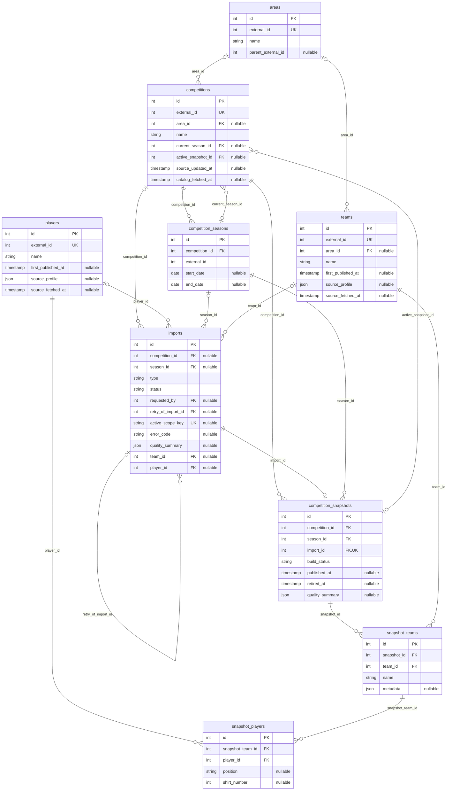
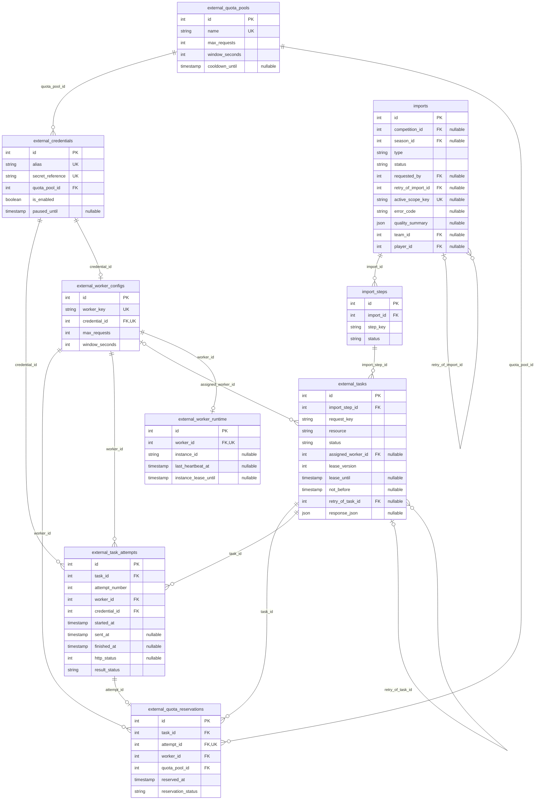
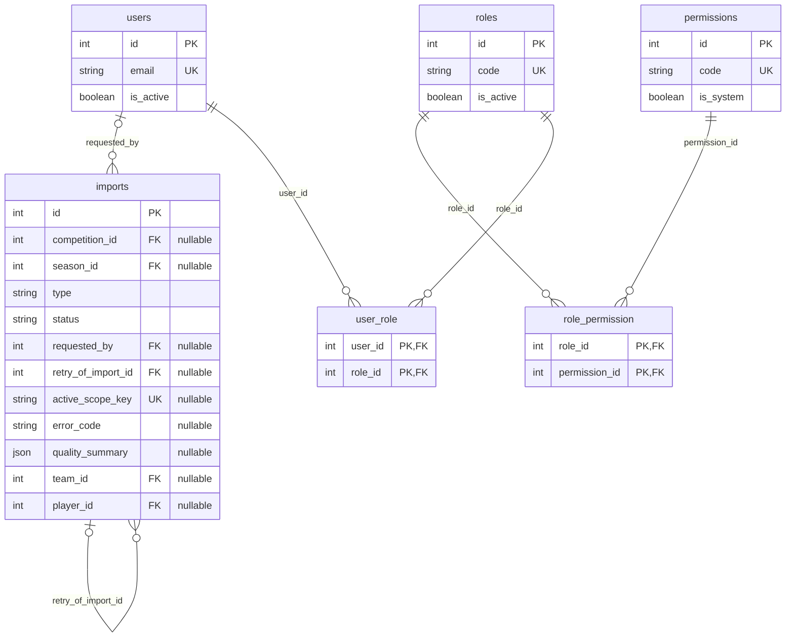

# Modelo entidad-relación del esquema implementado

Este modelo acompaña al [proceso técnico](10_proceso_tecnico.md) y a la [guía de implementación](09_backend_implementacion.md). Se contrastó con las siete migraciones aplicadas y con columnas, índices y claves foráneas del MySQL local. Incluye **35 tablas y 36 FK físicas**; los diagramas anteriores 03–05 describen partes del diseño original y este documento incorpora los detalles individuales actuales.

## Archivos y lectura del modelo

- [Diagrama completo en Mermaid](11_modelo_entidad_relacion.mmd): las 35 entidades, las 36 FK y referencias lógicas de infraestructura.
- [Diagrama editable en diagrams.net / draw.io](11_modelo_entidad_relacion.drawio): cuatro páginas con los mismos módulos que se muestran abajo. Abrir el archivo con diagrams.net permite mover entidades y seguir conectores.
- Los bloques Mermaid de este documento se visualizan en un visor Markdown con soporte Mermaid. Sus atributos muestran claves y campos relevantes; la lista completa de columnas está en las migraciones.

`PK` indica clave primaria, `FK` restricción foránea y `UK` unicidad de una columna. Las claves únicas compuestas se detallan en la sección 6: sus miembros no son únicos individualmente. Las PK compuestas de pivotes incluyen ambas columnas. Los comentarios `nullable` indican campos opcionales.

Los conectores continuos representan FK reales. Los punteados llevan la etiqueta **sin FK** y representan referencias lógicas; no afirman integridad referencial garantizada por MySQL. La cardinalidad al lado del padre es `||` (uno obligatorio) u `o|` (cero o uno por FK nullable); al lado del hijo es `o{` (cero o muchos) u `o|` (cero o uno por FK única).

Las cardinalidades describen restricciones físicas. Por ejemplo, MySQL permite varias competiciones apuntando a un mismo snapshot porque `active_snapshot_id` no es único; la aplicación comprueba pertenencia y usa un solo snapshot activo por competición. La relación inversa muestra esa posibilidad física, no una regla de compartir publicaciones entre competiciones.

## 1. Fútbol, temporadas y versiones publicadas

La identidad global se separa de las participaciones de cada publicación. `teams.external_id` y `players.external_id` permiten reutilizar una identidad en varias versiones, mientras `snapshot_teams` y `snapshot_players` conservan los valores propios de cada snapshot. `competitions.active_snapshot_id` selecciona la versión visible.

`imports` también aparece en otros módulos para mostrar sus relaciones. Los tipos de importación determinan el objetivo: catálogo sin entidad, competición con temporada cuando se resuelve, equipo por `team_id` y persona por `player_id`. Estos campos son nullable y la exclusión entre objetivos la aplica el código; la migración no declara un CHECK que imponga un único tipo de entidad.

## 2. Ejecución externa, workers y cuota

La trazabilidad se recorre como `imports → import_steps → external_tasks → external_task_attempts`. Cada intento referencia al worker y a la credencial; cada reserva contabiliza cuota para ese intento y su pool.

`external_worker_configs.credential_id` es único: una credencial de configuración se asigna como máximo a un worker. `external_worker_runtime.worker_id` permite un registro de actividad por configuración. `external_quota_reservations.attempt_id` permite como máximo una reserva por intento; el código la crea junto al intento bajo transacción.

`external_tasks.assigned_worker_id` describe la última reserva. El historial de quién trabajó cada intento está en `external_task_attempts.worker_id`, junto con `credential_id` y `attempt_number`. Los índices únicos de tarea/worker y tarea/credencial impiden reutilizarlos dentro de esa tarea.

`retry_of_task_id` existe como FK nullable, pero los reintentos HTTP implementados conservan la misma tarea y agregan intentos. Un reintento manual de importación utiliza `imports.retry_of_import_id` y crea trabajos nuevos, salvo que ya exista uno activo del mismo ámbito.

## 3. Usuarios, roles y permisos

Los pivotes implementan relaciones muchos-a-muchos con PK compuesta. La importación puede conservar al usuario solicitante; si se elimina ese usuario, `requested_by` pasa a `null` y el historial permanece.

Los permisos son independientes y el servidor los revalida. La presencia de un rol o permiso en estas tablas no crea una relación entre credenciales del proveedor y usuarios de la SPA.

## 4. Passport e infraestructura del framework

Estas migraciones crean índices/referencias lógicas de OAuth y sesión sin restricciones FK físicas. Las tablas de cola/caché y `migrations` también se incluyen; una tabla sin conector permanece independiente a nivel referencial.

```mermaid
erDiagram
    users {
        int id PK
        string email UK
        boolean is_active
    }
    oauth_clients {
        string id PK
        string owner_type "nullable"
        int owner_id "nullable"
        text grant_types
    }
    oauth_access_tokens {
        string id PK
        int user_id "nullable"
        string client_id
        boolean revoked
        datetime expires_at "nullable"
    }
    oauth_refresh_tokens {
        string id PK
        string access_token_id
        boolean revoked
        datetime expires_at "nullable"
    }
    oauth_auth_codes {
        string id PK
        int user_id
        string client_id
        datetime expires_at "nullable"
    }
    oauth_device_codes {
        string id PK
        int user_id "nullable"
        string client_id
        string user_code UK
        datetime expires_at "nullable"
    }
    sessions {
        string id PK
        int user_id "nullable"
        int last_activity
    }
    password_reset_tokens {
        string email PK
        string token
        timestamp created_at "nullable"
    }
    external_tasks {
        int id PK
        int import_step_id FK
        string request_key
        string resource
        string status
        int assigned_worker_id FK "nullable"
        int lease_version
        timestamp lease_until "nullable"
        timestamp not_before "nullable"
        int retry_of_task_id FK "nullable"
        json response_json "nullable"
    }
    jobs {
        int id PK
        string queue
        longtext payload
        int attempts
        int reserved_at "nullable"
        int available_at
    }
    failed_jobs {
        int id PK
        string uuid UK
        text queue
        longtext payload
        timestamp failed_at
    }
    job_batches {
        string id PK
        int total_jobs
        int pending_jobs
        int failed_jobs
    }
    cache {
        string key PK
        mediumtext value
        int expiration
    }
    cache_locks {
        string key PK
        string owner
        int expiration
    }
    migrations {
        int id PK
        string migration
        int batch
    }
    external_tasks o|--o{ external_tasks : "retry_of_task_id"
    users o|..o{ sessions : "user_id sin FK"
    users o|..o{ oauth_access_tokens : "user_id sin FK"
    users o|..o{ oauth_auth_codes : "user_id sin FK"
    users o|..o{ oauth_device_codes : "user_id sin FK"
    oauth_clients o|..o{ oauth_access_tokens : "client_id sin FK"
    oauth_clients o|..o{ oauth_auth_codes : "client_id sin FK"
    oauth_clients o|..o{ oauth_device_codes : "client_id sin FK"
    oauth_access_tokens o|..o{ oauth_refresh_tokens : "access_token_id sin FK"
    users o|..o{ password_reset_tokens : "email sin FK"
    external_tasks o|..o{ jobs : "taskId en payload sin FK"
    external_tasks o|..o{ failed_jobs : "taskId en payload sin FK"
```

`oauth_clients.owner_id`/`owner_type` es una referencia polimórfica nullable, que puede señalar distintos modelos; por eso no se dibuja una FK fija hacia `users`. `password_reset_tokens.email` es una referencia lógica por correo. La API actual usa los tokens personales de Passport, aunque las migraciones también incluyan infraestructura para otros flujos OAuth.

Los Jobs de `ProcessExternalTask` guardan un `taskId` serializado dentro de `jobs.payload`; no hay columna `jobs.task_id`. `failed_jobs.payload` puede conservarlo si un Job de ese tipo falla técnicamente. Los conectores de payload describen ese Job concreto; las tablas Laravel pueden alojar otros tipos de Job. `job_batches` está creada como infraestructura y las importaciones actuales no utilizan sus lotes.

## 5. Inventario completo de claves foráneas

En esta tabla, «Nullable» se refiere a la FK del hijo y «Hijos por padre» representa el máximo permitido por sus índices. Un padre puede no tener hijos. `NO ACTION` conserva la restricción y obliga a resolver referencias antes de eliminar al padre.

| Columna del hijo | Referencia | Nullable | Hijos por padre | ON DELETE |
|---|---|---|---|---|
| `competition_seasons.competition_id` | `competitions.id` | No | 0..N | `CASCADE` |
| `competition_snapshots.competition_id` | `competitions.id` | No | 0..N | `NO ACTION` |
| `competition_snapshots.import_id` | `imports.id` | No | 0..1 | `NO ACTION` |
| `competition_snapshots.season_id` | `competition_seasons.id` | No | 0..N | `NO ACTION` |
| `competitions.active_snapshot_id` | `competition_snapshots.id` | Sí | 0..N | `SET NULL` |
| `competitions.area_id` | `areas.id` | Sí | 0..N | `NO ACTION` |
| `competitions.current_season_id` | `competition_seasons.id` | Sí | 0..N | `SET NULL` |
| `external_credentials.quota_pool_id` | `external_quota_pools.id` | No | 0..N | `NO ACTION` |
| `external_quota_reservations.attempt_id` | `external_task_attempts.id` | No | 0..1 | `NO ACTION` |
| `external_quota_reservations.quota_pool_id` | `external_quota_pools.id` | No | 0..N | `NO ACTION` |
| `external_quota_reservations.task_id` | `external_tasks.id` | No | 0..N | `NO ACTION` |
| `external_quota_reservations.worker_id` | `external_worker_configs.id` | No | 0..N | `NO ACTION` |
| `external_task_attempts.credential_id` | `external_credentials.id` | No | 0..N | `NO ACTION` |
| `external_task_attempts.task_id` | `external_tasks.id` | No | 0..N | `NO ACTION` |
| `external_task_attempts.worker_id` | `external_worker_configs.id` | No | 0..N | `NO ACTION` |
| `external_tasks.assigned_worker_id` | `external_worker_configs.id` | Sí | 0..N | `NO ACTION` |
| `external_tasks.import_step_id` | `import_steps.id` | No | 0..N | `NO ACTION` |
| `external_tasks.retry_of_task_id` | `external_tasks.id` | Sí | 0..N | `NO ACTION` |
| `external_worker_configs.credential_id` | `external_credentials.id` | No | 0..1 | `NO ACTION` |
| `external_worker_runtime.worker_id` | `external_worker_configs.id` | No | 0..1 | `NO ACTION` |
| `import_steps.import_id` | `imports.id` | No | 0..N | `NO ACTION` |
| `imports.competition_id` | `competitions.id` | Sí | 0..N | `NO ACTION` |
| `imports.player_id` | `players.id` | Sí | 0..N | `NO ACTION` |
| `imports.requested_by` | `users.id` | Sí | 0..N | `SET NULL` |
| `imports.retry_of_import_id` | `imports.id` | Sí | 0..N | `SET NULL` |
| `imports.season_id` | `competition_seasons.id` | Sí | 0..N | `NO ACTION` |
| `imports.team_id` | `teams.id` | Sí | 0..N | `NO ACTION` |
| `role_permission.permission_id` | `permissions.id` | No | 0..N | `CASCADE` |
| `role_permission.role_id` | `roles.id` | No | 0..N | `CASCADE` |
| `snapshot_players.player_id` | `players.id` | No | 0..N | `NO ACTION` |
| `snapshot_players.snapshot_team_id` | `snapshot_teams.id` | No | 0..N | `CASCADE` |
| `snapshot_teams.snapshot_id` | `competition_snapshots.id` | No | 0..N | `CASCADE` |
| `snapshot_teams.team_id` | `teams.id` | No | 0..N | `NO ACTION` |
| `teams.area_id` | `areas.id` | Sí | 0..N | `NO ACTION` |
| `user_role.role_id` | `roles.id` | No | 0..N | `CASCADE` |
| `user_role.user_id` | `users.id` | No | 0..N | `CASCADE` |

Las cascadas de snapshot borran participaciones de la versión eliminada, sin borrar identidades globales de clubes/personas. Las FK de `competitions` hacia temporada actual y snapshot activo usan `SET NULL`, y los servicios de limpieza excluyen previamente cualquier snapshot activo.

## 6. Claves primarias y únicas

| Tabla | PK | Otras restricciones UNIQUE |
|---|---|---|
| `areas` | `id` | `external_id` |
| `cache` | `key` | — |
| `cache_locks` | `key` | — |
| `competition_seasons` | `id` | `competition_id, external_id` |
| `competition_snapshots` | `id` | `import_id` |
| `competitions` | `id` | `external_id` |
| `external_credentials` | `id` | `alias`; `secret_reference` |
| `external_quota_pools` | `id` | `name` |
| `external_quota_reservations` | `id` | `attempt_id` |
| `external_task_attempts` | `id` | `task_id, attempt_number`; `task_id, credential_id`; `task_id, worker_id` |
| `external_tasks` | `id` | `import_step_id, request_key` |
| `external_worker_configs` | `id` | `credential_id`; `worker_key` |
| `external_worker_runtime` | `id` | `worker_id` |
| `failed_jobs` | `id` | `uuid` |
| `import_steps` | `id` | `import_id, step_key` |
| `imports` | `id` | `active_scope_key` |
| `job_batches` | `id` | — |
| `jobs` | `id` | — |
| `migrations` | `id` | — |
| `oauth_access_tokens` | `id` | — |
| `oauth_auth_codes` | `id` | — |
| `oauth_clients` | `id` | — |
| `oauth_device_codes` | `id` | `user_code` |
| `oauth_refresh_tokens` | `id` | — |
| `password_reset_tokens` | `email` | — |
| `permissions` | `id` | `code` |
| `players` | `id` | `external_id` |
| `role_permission` | `role_id, permission_id` | — |
| `roles` | `id` | `code` |
| `sessions` | `id` | — |
| `snapshot_players` | `id` | `snapshot_team_id, player_id` |
| `snapshot_teams` | `id` | `snapshot_id, team_id` |
| `teams` | `id` | `external_id` |
| `user_role` | `user_id, role_id` | — |
| `users` | `id` | `email` |

La unicidad de `competition_seasons.external_id` se aplica dentro de su competición. Los pares de snapshot impiden repetir al mismo equipo en una versión y al mismo jugador dentro de un equipo de esa versión. `imports.active_scope_key` admite varios `null` y restringe los scopes activos a una sola importación. Las FK/índices garantizan identidad y trazabilidad; validaciones como pertenencia a temporada, estructura de plantilla y límite de tres intentos se aplican en los servicios.

## 7. Referencias dentro de JSON

| Campo | Contenido | Relación con el modelo relacional |
|---|---|---|
| `teams.source_profile.squad` | Plantilla del último detalle individual válido. | Sus IDs son externos; el importador registra identidades en `players`, pero la asociación vive en JSON y no en `snapshot_players`. |
| `teams.source_profile.running_competitions` | Competiciones declaradas por el club. | Sus objetos no crean una FK ni garantizan que exista la identidad local. |
| `players.source_profile.current_team` | Equipo actual y contrato declarados por el detalle de persona. | Referencia externa en JSON; no equivale a una participación publicada ni crea automáticamente `teams`. |
| `snapshot_teams.metadata` | Área, entrenador, competiciones y datos del club recibidos en esa versión. | Los objetos internos no son nuevas tablas; las FK del snapshot usan `snapshot_id` y `team_id`. |
| `external_tasks.response_json` | Cuerpo de respuesta HTTP exitosa guardado para persistencia/recuperación. | Conserva datos del proveedor; la validación decide qué identidades y participaciones publicar. |

`areas.parent_external_id` también referencia un ID del proveedor y no tiene FK hacia `areas.id`. Las URLs REST usan IDs externos de entidades de fútbol y las relaciones SQL usan PK internas. Mantener esta distinción evita enlazar una FK local con un ID del proveedor.

## 8. Validación del documento

Se verificó que las 35 entidades del diagrama existan en MySQL, que los atributos dibujados sean columnas reales y que las 36 relaciones físicas coincidan con las FK del esquema. El inventario incluye nullable, unicidad y comportamiento de borrado. No se consultaron filas de usuarios, tokens ni respuestas del proveedor para construir el ER.
