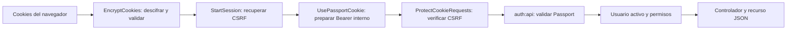

# Autenticación con cookies de sesión y Laravel Passport

La SPA conserva la autenticación en una cookie de sesión protegida. El navegador la envía a la API y el servidor valida el JWT mediante el guard `api`, cuyo driver continúa siendo `passport`. Al recargar una ficha, la SPA consulta `/api/auth/me` antes de navegar y recupera usuario y capacidades.

El [proceso técnico](10_proceso_tecnico.md) describe las consultas/importaciones y el [ER](11_modelo_entidad_relacion.md) identifica las tablas. Este cambio utiliza tablas existentes y no agrega migraciones.

## 1. Cookies y almacenamiento

| Cookie | Contenido | Alcance y protección |
|---|---|---|
| `incarail_access_token` | JWT de Passport, cifrado por `EncryptCookies` usando `APP_KEY`. | Sesión: sin expiración persistente; `HttpOnly`, `SameSite=Strict`, host actual y ruta `/api`. `Secure` según HTTPS/configuración. |
| `incarail_session` | Identificador cifrado de la sesión Laravel. | Cookie de sesión, `HttpOnly`, `SameSite=Lax`, host actual y ruta `/`. |
| `XSRF-TOKEN` | Token CSRF cifrado de la sesión, accesible a Axios. | Cookie de sesión, `SameSite=Lax`, host actual y ruta `/`. No contiene el JWT de autenticación. |

La cookie de autenticación usa expiración `0`; `session.expire_on_close = true` aplica ese comportamiento al identificador Laravel y el middleware CSRF también usa expiración `0`. Son cookies de sesión del navegador. El JWT conserva una validez absoluta de **120 minutos**, aunque el navegador siga abierto; no se renueva automáticamente al consultar una ficha.

JavaScript no recibe el JWT en el JSON de login, no lo guarda en memoria, `localStorage` o `sessionStorage`, y no construye el Bearer de la SPA. Pinia mantiene solamente perfil/capacidades para presentar la interfaz. Passport guarda identificador, usuario, cliente, scopes, revocación y expiración en `oauth_access_tokens`; esa tabla no almacena el JWT completo.

La tabla `sessions` conserva CSRF y datos auxiliares del framework mediante el driver `database` del entorno local. El JWT permanece en la cookie protegida. Las pruebas usan sesiones `array` y SQLite en memoria.

## 2. Login y recuperación al recargar

1. La SPA solicita `GET /api/auth/csrf-cookie`, público y limitado a 120 solicitudes/minuto. Laravel prepara sesión y cookies CSRF.
2. Axios lee `XSRF-TOKEN`, decodifica el valor de cookie y lo envía como `X-XSRF-TOKEN`; el JWT `HttpOnly` permanece inaccesible a JavaScript.
3. La SPA hace `POST /api/auth/login` con correo/contraseña. CSRF se verifica incluso con `Sec-Fetch-Site: same-origin`; un token faltante/incorrecto devuelve **419** antes del controlador.
4. `LoginRequest` valida campos y `AuthController` comprueba usuario activo y contraseña mediante `Hash::check`.
5. Un login válido revoca el token previo de la petición, si existe, regenera identificador y token CSRF de sesión y crea un token personal `inca-rail-spa`.
6. La respuesta guarda el JWT en `incarail_access_token` y devuelve perfil/tiempo de validez. `EncryptCookies` cifra el valor antes de enviarlo.

Ejemplo del nuevo cuerpo de respuesta, omitiendo campos del perfil:

```json
{
  "success": true,
  "data": {
    "expires_in": 7200,
    "user": { "id": 7, "name": "Usuario", "permissions": [], "abilities": [] }
  },
  "message": "Autenticación correcta.",
  "meta": {},
  "error": null
}
```

El JWT se entrega mediante `Set-Cookie`; el JSON ya no incluye `access_token` ni `token_type`. Un cliente de este login debe conservar cookies, preparar CSRF y enviar su encabezado al hacer POST. Los clientes con un Bearer explícito previamente obtenido continúan autenticándose mediante Passport.

Al iniciar la SPA, `sessionGuard` espera `session.restore()`, que consulta `GET /api/auth/me` con cookies. Si recupera la sesión, conserva la URL completa de una ficha y su origen `from`. Las llamadas concurrentes de restauración comparten una petición. Un 401/403 inicial conduce al login sin un bucle de aviso de expiración; un fallo de red deja la comprobación pendiente para reintentar y muestra el estado de sesión no comprobada en login.

## 3. Validación de cada solicitud

El grupo `api` incorpora cookies/sesión antes de autenticación:



`UsePassportCookie` convierte el JWT descifrado en `Authorization: Bearer` dentro del servidor. Un Bearer explícito conserva prioridad. La cookie propia no usa el token transitorio de `CreateFreshApiToken`: Passport sigue verificando firma RSA, fechas del JWT, registro no revocado, cliente OAuth activo y usuario existente.

Las mutaciones autenticadas mediante cookie y el login verifican CSRF. Se aceptan `X-XSRF-TOKEN` cifrado de Axios o `X-CSRF-TOKEN` con el token correspondiente. GET/HEAD/OPTIONS conservan la regla de lectura del framework. `SameSite=Strict` restringe el envío del JWT entre sitios, incluyendo GET que pueden iniciar importaciones implícitas. La SPA y sus peticiones al proxy se realizan en el mismo origen.

Un cliente con Bearer explícito no necesita el CSRF de una cookie para sus operaciones protegidas; el endpoint de login sigue requiriendo preparar CSRF.

| Control | Resultado |
|---|---|
| JWT ausente, alterado, expirado, revocado o cliente OAuth revocado | 401 `UNAUTHENTICATED`; elimina la cookie de autenticación. |
| CSRF ausente/incorrecto en login o mutación con cookie | 419 `CSRF_TOKEN_MISMATCH`; no ejecuta la operación. |
| Usuario inactivo | 403 en operaciones protegidas; logout permite revocar su token. |
| Permiso requerido ausente o rol/permiso inactivo | 403; los permisos se consultan en MySQL en cada petición. |
| Credenciales de login incorrectas | 401 `INVALID_CREDENTIALS` con mensaje genérico. |
| Límite de solicitudes | Login 10/minuto; CSRF y rutas protegidas 120/minuto; superarlo devuelve 429. |
| Datos inválidos | 422 con validaciones del Form Request. |

Autenticación y solicitudes identificadas por cookie usan `Cache-Control: no-store, private`. Las contraseñas se guardan como hash y no se serializan en el perfil. CASL presenta controles y el servidor conserva la decisión de autorización.

## 4. CSRF caducado y cierre de sesión

Ante un 419, Axios prepara nuevamente CSRF y repite **una sola vez** la petición rechazada. El rechazo ocurre antes del controlador, por lo que no duplica una operación ejecutada. Si el segundo intento falla, conserva el diagnóstico. La preparación CSRF también comparte una petición entre solicitudes concurrentes.

Un 401 durante una sesión establecida limpia perfil/capacidades y devuelve la SPA a `/login?expired=1`; el servidor elimina la cookie. La restauración inicial y el login inválido no producen ese aviso global.

`POST /api/auth/logout` requiere autenticación y CSRF cuando utiliza cookie. Revoca el token actual, invalida la sesión Laravel, regenera CSRF y elimina `incarail_access_token` con su mismo host/ruta. Una copia del token anterior deja de autenticar por la revocación de Passport. Un login nuevo también revoca el token previo de la petición.

La SPA limpia el perfil después de confirmar logout, o cuando el servidor informa que el token ya no autentica. Un fallo de red al cerrar sesión mantiene el perfil y muestra el error para reintentar: JavaScript no puede eliminar una cookie `HttpOnly`. Se revoca el token de esa sesión, no todos los del usuario.

## 5. Configuración y despliegue

| Parámetro | Ubicación | Valor |
|---|---|---|
| Nombre de cookie JWT | `config/auth.php`, `session_cookie.name` | `incarail_access_token`. |
| Atributos del JWT | `app/Support/SessionTokenCookie.php` | `/api`, sin `Domain`, `HttpOnly`, `SameSite=Strict`, sesión. |
| Duración JWT | `AppServiceProvider` | Tokens y tokens personales: 120 minutos. |
| Sesión auxiliar | `config/session.php` | 120 minutos del servidor; driver de `.env`; cookie de sesión. |
| `Secure` | `SESSION_SECURE_COOKIE` / HTTPS | Automático si la variable no está definida. |
| Cliente SPA | `frontend/src/lib/api.js` | `withCredentials` y `withXSRFToken` habilitados. |

En HTTP local se envían cookies a `localhost:5173` mediante el proxy. En HTTPS usan `Secure`; si TLS termina en un proxy y PHP recibe HTTP internamente, configurar **`SESSION_SECURE_COOKIE=true`** en el archivo privado del despliegue. Mantener `APP_KEY` y claves de Passport fuera del repositorio. La cookie es cifrada, el JWT firmado y HTTPS protege el transporte.

Las cookies se limitan al host actual. La restauración de pestañas del navegador puede conservar cookies de sesión al restaurar una sesión del navegador; el JWT sigue venciendo a los 120 minutos. No hay renovación automática ni doble factor en este cambio.

El esquema ya contiene `sessions` y OAuth. No se necesita migración adicional. API y Vite sirven los cambios; el usuario debe iniciar sesión una vez para recibir la cookie, porque la versión anterior conservaba el token solamente en memoria.

## 6. Código y comprobación

| Parte | Archivo |
|---|---|
| Emisión/revocación y perfil | [AuthController](../backend/app/Http/Controllers/AuthController.php). |
| Cookie protegida | [SessionTokenCookie](../backend/app/Support/SessionTokenCookie.php). |
| Adaptación a Passport | [UsePassportCookie](../backend/app/Http/Middleware/UsePassportCookie.php). |
| CSRF | [ProtectCookieRequests](../backend/app/Http/Middleware/ProtectCookieRequests.php). |
| Orden de middleware | [bootstrap/app.php](../backend/bootstrap/app.php). |
| Errores/eliminación de cookie inválida | [ApiExceptionRenderer](../backend/app/Exceptions/ApiExceptionRenderer.php). |
| Rutas | [api.php](../backend/routes/api.php). |
| HTTP y renovación CSRF | [api.js](../frontend/src/lib/api.js). |
| Recuperación | [session.js](../frontend/src/stores/session.js), [sessionGuard.js](../frontend/src/lib/sessionGuard.js). |
| Pruebas | [CookieSessionTest](../backend/tests/Feature/CookieSessionTest.php), [session.test.mjs](../frontend/tests/session.test.mjs). |

Pasaron **104 pruebas de backend (825 comprobaciones)** y **60 de frontend**, Pint sobre diez archivos PHP y la compilación de Vite. Las pruebas de cookies usan claves RSA temporales, tokens reales de Passport y CSRF habilitado. Comprueban atributos/cifrado, fijación de sesión, token/cookie alterados, expiración, revocación, cliente revocado, permisos, usuario inactivo, HTTPS, Bearer explícito y nuevo login. El frontend comprueba recuperación antes de navegar, URL original, sesión anónima, login sin JWT en JSON, reintento CSRF limitado, expiración, logout y fallos de red.

También se verificó el flujo HTTP real a través de `localhost:5173` con un usuario temporal readonly: preparación CSRF, login sin encabezado rechazado con 419, login válido, restauración con un nuevo cliente y el mismo cookie jar, lectura autorizada de equipos, logout sin CSRF rechazado, logout válido con revocación y posterior 401. Se eliminaron el usuario temporal, sus tokens y sesiones registradas de verificación. No se solicitaron importaciones ni datos externos. Esta comprobación valida proxy y cabeceras; la inspección del navegador quedó pendiente porque no había uno conectado.
